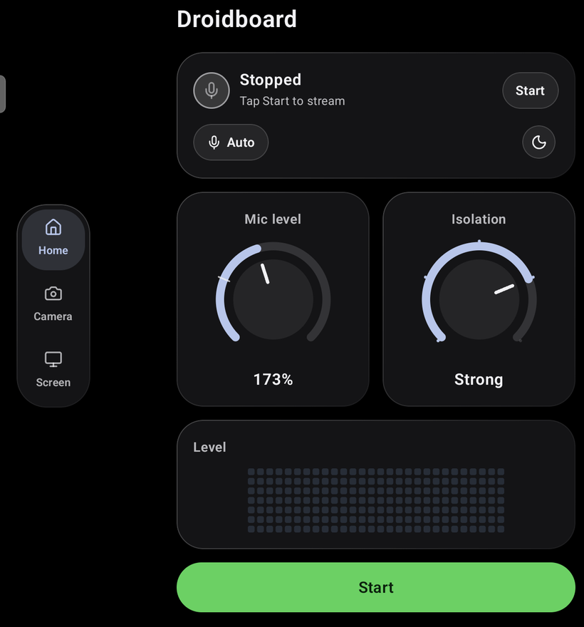
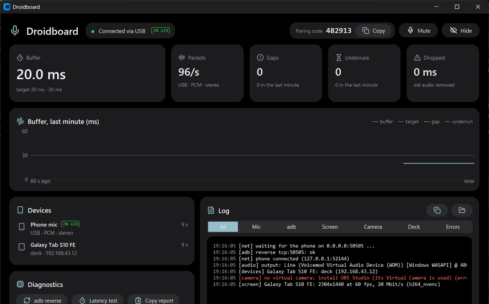

<div dir="rtl">

# Droidboard

[English](README.md) · **العربية**

حوّل جوالك أو تابلتك الأندرويد إلى مايك، ولوحة أزرار، وكاميرا ويب، وشاشة ثانية للابتوبك الويندوز.


> [!NOTE]
> هذي أول نسخة بيتا، وممكن يطلع فيها أخطاء. إذا شي ما اشتغل معك، افتح issue.

<p>
  
  
</p>

## وش يسوي

- **المايك:** جوالك يصير مايك لـ Discord وZoom وTeams وOBS وأي برنامج ثاني. يشتغل عبر USB أو Wi-Fi، بصوت Mono أو Stereo. التأخير على USB حوالي 150 ms.
- **الـ Deck:** شبكة أزرار على التابلت تفتح برامج، أو تضغط اختصارات، أو تتحكم بالصوت والفيديو في اللابتوب.
- **كاميرا الويب:** كاميرا الجوال تطلع في اللابتوب ككاميرا ويب.
- **الشاشة الثانية:** التابلت يصير شاشة إضافية، وتقدر تستخدم اللمس عليها.

## وش تحتاج

| لـ | تحتاج |
|---|---|
| كل شي | لابتوب Windows 10 أو 11، وجوال أو تابلت Android 8 أو أحدث |
| المايك | [VB-Cable](https://vb-audio.com/Cable/) (مجاني). Droidboard يشغّل صوتك فيه، والبرامج تسمعه كمايك |
| USB | [Android platform-tools](https://developer.android.com/tools/releases/platform-tools) (فيها adb) في الـ `PATH`، وتفعيل **USB debugging** من Developer options في الجوال |
| Wi-Fi | الجوال واللابتوب على نفس الشبكة |
| كاميرا الويب | [OBS Studio](https://obsproject.com/)، لأن Droidboard يستخدم الكاميرا الوهمية حقته |
| الشاشة الثانية كشاشة إضافية | [Virtual Display Driver](https://github.com/VirtualDrivers/Virtual-Display-Driver). بدونه، التابلت يعرض نسخة من شاشتك الرئيسية |

## التثبيت

1. ثبّت **VB-Cable** أول شي، وأعد تشغيل اللابتوب إذا طلب.
2. نزّل `Droidboard-windows.zip` و`Droidboard.apk` من [آخر إصدار](https://github.com/Sabra7/Droidboard/releases/latest).
3. ثبّت `Droidboard.apk` على الجوال أو التابلت.
4. فك ضغط `Droidboard-windows.zip` في أي مكان وشغّل `Droidboard.exe`. إذا سألك Windows Firewall، اسمح له على الشبكات الخاصة (private).
5. وصّل الجوال:
   - **USB:** ركّب السلك، وDroidboard يلقى الجوال بنفسه.
   - **Wi-Fi:** في التطبيق افتح الترس وبعدها **Connection**، واختر Wi-Fi، واكتب **Pairing code** اللي يطلع في نافذة Droidboard على اللابتوب.
6. اضغط **Start** في التطبيق.

## الاستخدام

**المايك.** في Discord أو Zoom أو أي برنامج، اختر **CABLE Output (VB-Audio Virtual Cable)** كمايك. في التطبيق، مقبض **Mic level** يتحكم بعلو صوتك، و**Isolation** يقلل الأصوات اللي حولك. اضغط على زر المايك عشان تختار أي مايك في الجوال، أو Mono أو Stereo. تقدر تكتم من التطبيق، أو من نافذة اللابتوب، أو من أيقونة الـ tray.

**الـ Deck.** في الجوال افتح تبويب **Deck**. وفي التابلت بالعرض، الـ Deck ياخذ النص اليمين من Home. عشان تعدّل الأزرار، اضغط كليك يمين على أيقونة Droidboard في الـ tray واختر **Edit deck...**، أو عدّلها من التابلت.

**كاميرا الويب.** افتح تبويب **Camera** واضغط **Send to the laptop**، وبعدها اختر **OBS Virtual Camera** في برنامج الفيديو.

**الشاشة الثانية.** في التابلت افتح تبويب **Screen**، واختر **Extend** أو **Mirror**، واضغط **Start second screen**.

**في اللابتوب.** نافذة Droidboard تعرض الاتصال، وبافر الصوت، وأجهزتك، وlog مباشر. إذا قفلتها يبقى شغّال في الـ tray. ومن أيقونة الـ tray تقدر تكتم، وتختار جهاز الإخراج أو التأخير، وتختار أي جوال هو المايك، وتفعّل **Start with Windows**.

## المشاكل الشائعة

| المشكلة | جرّب |
|---|---|
| اللابتوب ما يشوف الجوال عبر USB | فعّل USB debugging، وافصل السلك وركّبه من جديد، ووافق على رسالة "Allow USB debugging" في الجوال. وتأكد إن `adb devices` يعرض الجوال |
| Droidboard يقفل أول ما يفتح | VB-Cable مو مثبت. ثبّته وشغّل Droidboard من جديد |
| الجوال ما يلقى اللابتوب على Wi-Fi | لازم يكونون على نفس الشبكة. واسمح لـ Droidboard في Windows Firewall (يستخدم منافذ TCP وUDP من 50505 إلى 50510) |
| الصوت يقطّع | كليك يمين على أيقونة الـ tray، وروح لـ **Latency** واختر بافر أكبر |
| كاميرا الويب ما تطلع | ثبّت OBS Studio، وبعدها أعد تشغيل Droidboard |

الـ log موجود في النافذة، و**Open log** في قائمة الـ tray يفتح ملف الـ log.

## الحالة

Droidboard نسخة بيتا. USB هو الأكثر تجربة. Wi-Fi يشتغل بس ما انجرّب بنفس القدر. البلوتوث تجريبي ومطفي افتراضيًا.

## البناء من المصدر

تحتاج Python 3.10 أو أحدث، وAndroid Studio.

```bash
git clone https://github.com/Sabra7/Droidboard.git
cd Droidboard/windows
pip install -r requirements.txt
python receiver.py --gui --wifi
```

عشان تبني التطبيق، افتح مجلد `android` في Android Studio وشغّله على جوالك.

## الرخصة

[MIT](LICENSE). والأيقونات من [Lucide](https://lucide.dev) ([ISC](shared/LICENSE-lucide.txt)).

</div>
