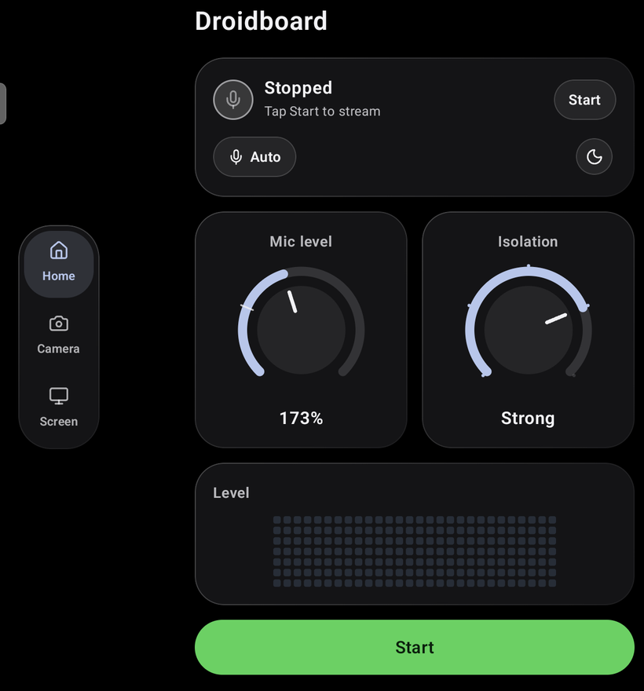
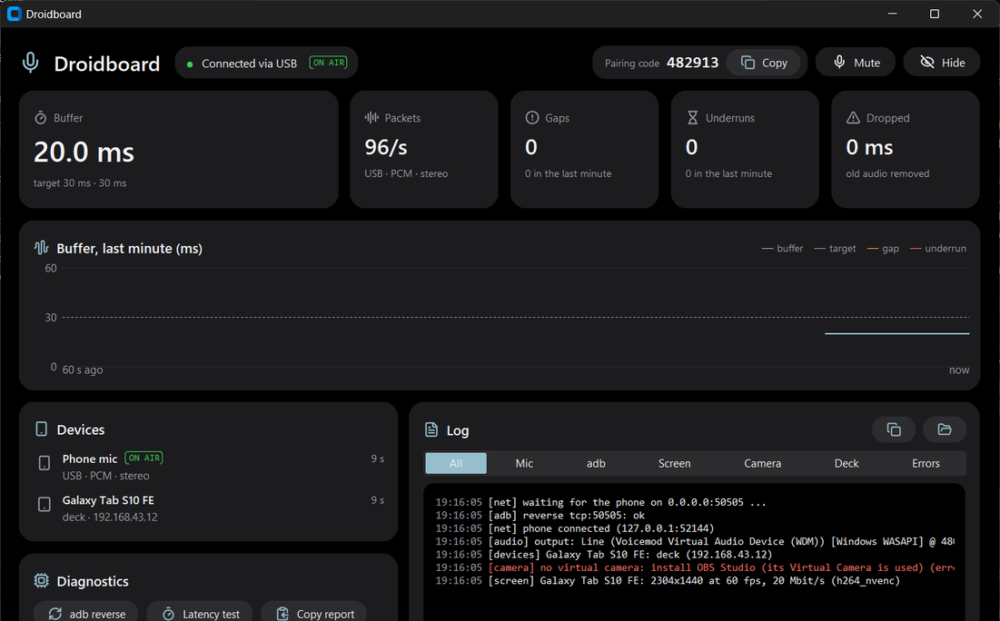

# Droidboard

**English** · [العربية](README.ar.md)

Turn your Android phone or tablet into a mic, a button deck, a webcam and a second screen for your Windows laptop.


> [!NOTE]
> This is the first beta. Things may break. If something doesn't work, please open an issue.

<p>
  
  
</p>

## What it does

- **Mic:** your phone becomes a microphone for Discord, Zoom, Teams, OBS or any app. Works over USB or Wi-Fi, in mono or stereo. Over USB the delay is about 150 ms.
- **Deck:** a grid of buttons on your tablet that open apps, press shortcuts or control media on the laptop.
- **Webcam:** the phone's camera shows up as a webcam on the laptop.
- **Second screen:** your tablet becomes an extra monitor, and you can use touch on it.

## What you need

| For | You need |
|---|---|
| Everything | A Windows 10 or 11 laptop and an Android 8+ phone or tablet |
| The mic | [VB-Cable](https://vb-audio.com/Cable/) (free). Droidboard plays your voice into it, and your apps hear it as a mic |
| USB | [Android platform-tools](https://developer.android.com/tools/releases/platform-tools) (adb) in your `PATH`, and **USB debugging** on in the phone's Developer options |
| Wi-Fi | The phone and the laptop on the same network |
| The webcam | [OBS Studio](https://obsproject.com/) (Droidboard uses its virtual camera) |
| The second screen as an extra monitor | [Virtual Display Driver](https://github.com/VirtualDrivers/Virtual-Display-Driver). Without it, the tablet shows a copy of your main screen |

## Install

1. Install **VB-Cable** first, and restart the laptop if it asks you to.
2. Download `Droidboard-windows.zip` and `Droidboard.apk` from the [latest release](https://github.com/Sabra7/Droidboard/releases/latest).
3. Install `Droidboard.apk` on your phone or tablet.
4. Unzip `Droidboard-windows.zip` anywhere and run `Droidboard.exe`. If Windows Firewall asks, allow it on private networks.
5. Connect the phone:
   - **USB:** plug in the cable. Droidboard finds the phone on its own.
   - **Wi-Fi:** in the app, open the gear and then **Connection**, choose Wi-Fi, and type the **pairing code** shown in the Droidboard window on the laptop.
6. Tap **Start** in the app.

## Using it

**Mic.** In Discord, Zoom or any app, pick **CABLE Output (VB-Audio Virtual Cable)** as your microphone. In the app, the **Mic level** knob sets how loud you are, and **Isolation** cuts the noise around you. Tap the mic pill to choose which mic on the phone to use, or mono or stereo. You can mute from the app, the laptop window or the tray icon.

**Deck.** On a phone, open the **Deck** tab. On a tablet in landscape, the deck fills the right half of Home. To change the buttons, right-click the Droidboard tray icon and choose **Edit deck...**, or edit them on the tablet.

**Webcam.** Open the **Camera** tab and tap **Send to the laptop**. Then pick **OBS Virtual Camera** in your video app.

**Second screen.** On a tablet, open the **Screen** tab, choose **Extend** or **Mirror**, and tap **Start second screen**.

**On the laptop.** The Droidboard window shows the connection, the audio buffer, your devices and a live log. Close it and it keeps running in the tray. From the tray icon you can mute, pick the output device or the latency, choose which phone is the mic, and turn on **Start with Windows**.

## Troubleshooting

| Problem | Try this |
|---|---|
| The laptop doesn't see the phone over USB | Turn on USB debugging, unplug and plug the cable back in, and accept the "Allow USB debugging" prompt on the phone. Make sure `adb devices` lists the phone |
| Droidboard closes right after it opens | VB-Cable isn't installed. Install it and run Droidboard again |
| The phone can't find the laptop on Wi-Fi | Both must be on the same network. Allow Droidboard in Windows Firewall (it uses TCP and UDP ports 50505 to 50510) |
| The voice cuts out | Right-click the tray icon, go to **Latency** and choose a bigger buffer |
| The webcam doesn't show up | Install OBS Studio, then restart Droidboard |

The log is in the window, and **Open log** in the tray menu opens the log file.

## Status

Droidboard is in beta. USB is the most tested connection. Wi-Fi works but hasn't been tested as much. Bluetooth is experimental and off by default.

## Build from source

You need Python 3.10+ and Android Studio.

```bash
git clone https://github.com/Sabra7/Droidboard.git
cd Droidboard/windows
pip install -r requirements.txt
python receiver.py --gui --wifi
```

To build the app, open the `android` folder in Android Studio and run it on your phone.

## License

[MIT](LICENSE). The icons are from [Lucide](https://lucide.dev) ([ISC](shared/LICENSE-lucide.txt)).
